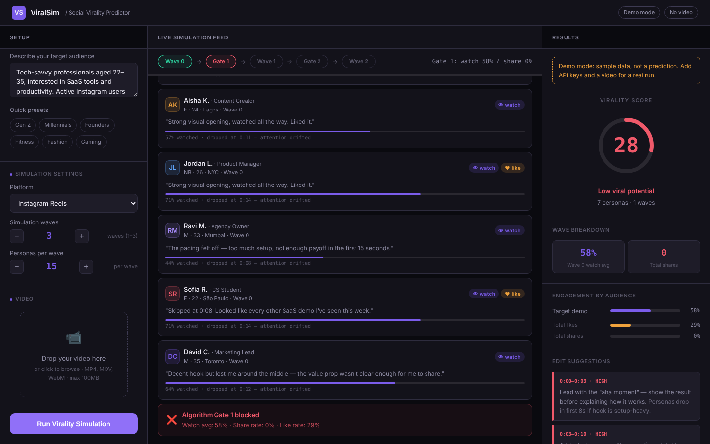
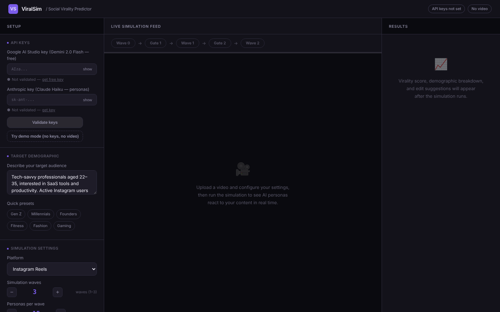

# ViralSim: Social Virality Simulator

A single-page tool that estimates how a short product video might spread on Instagram Reels, TikTok or YouTube Shorts. Instead of a black-box score, it runs a **simulated audience**: AI personas watch the video wave by wave, and the content only reaches a wider audience if it passes the same kind of engagement "gates" that recommendation algorithms use.



## The problem

Creators and early-stage marketers usually find out whether a video works *after* posting it. Analytics then show a number (low reach, low watch time) but not **why** people dropped off, or what to change. ViralSim gives a pre-launch read: who watches, where attention drops, who shares, and specific edit suggestions with timestamps.

## How it works

```
 video ──► frame sampling (8 frames: hook, 10 %, 25 % … 95 %)
              │
              ▼
   Gemini 2.0 Flash: video signals
   (hook, pacing, clarity, thumbnail appeal, estimated watch %, overall strength)
              │
              ▼
   Wave 0  target audience (7 personas)  ──► Gate 1: avg watch ≥ 55 % and share rate ≥ 15 %
   Wave 1  adjacent niche  (5 personas)  ──► Gate 2: avg watch ≥ 50 % and share rate ≥ 10 %
   Wave 2  mass "Explore"  (5 personas)
              │      each persona = Claude Haiku role-playing a profile with its own biases;
              │      returns watch %, like / share / save / comment, drop-off time and a verdict
              ▼
   Virality score (1–99) + audience breakdown + timestamped edit suggestions (Claude)
```

### Scoring formula

For each wave reached, a wave score is computed with platform-specific weights:

| Platform | Watch | Share | Like | Save |
|---|---|---|---|---|
| Instagram Reels | 0.40 | 0.35 | 0.15 | 0.10 |
| TikTok | 0.45 | 0.30 | 0.15 | 0.10 |
| YouTube Shorts | 0.50 | 0.25 | 0.15 | 0.10 |

`wave score = avgWatch·w_watch + min(3·shareRate, 1)·w_share + min(2·likeRate, 1)·w_like + min(2·saveRate, 1)·w_save` (×100)

Waves are weighted 0.40 / 0.35 / 0.25. The final score is `0.7 × Σ(weighted wave scores) + 0.3 × video signal strength`, clipped to 1–99. A video blocked at Gate 1 can therefore score at most 58, and one blocked at Gate 2 at most 83. That is deliberate: in the model, reaching a broad audience is part of being viral.

## Results and limitations

**ViralSim is a simulator, not a trained prediction model.** It has not been validated against real view counts, so there is **no accuracy figure**, and its score should be read as a structured second opinion, not a forecast. In particular:

- Persona reactions come from an LLM role-playing a profile. They are plausible, but they are not real viewers.
- The gate thresholds and weights are hand-set from public descriptions of how short-video ranking works. They are not fitted to data.
- The persona count is capped at 7 per wave (to stay within free-tier API limits), even if the UI is set higher.
- If a Gemini call fails, the app falls back to built-in sample signals. If a persona call fails, it uses a randomised placeholder response. Demo mode uses these placeholders on purpose and labels its results as sample data.

A natural next step would be calibration: running the simulator on videos with known reach and fitting the weights and gates to those outcomes.

## Tech stack

Plain HTML, CSS and JavaScript in one file (no build step, no backend) · Google Gemini 2.0 Flash (multimodal frame analysis) · Anthropic Claude Haiku (personas and edit suggestions) · Canvas API for frame extraction · Node's built-in test runner for unit tests.

## Run it

```bash
git clone https://github.com/Sharank874/ViralSim.git
cd ViralSim
open index.html          # macOS. Or double-click index.html, or: python3 -m http.server 8000
```

- **Without keys:** click **Try demo mode** and then **Run Virality Simulation** to see the full flow with sample data.
- **Real run:** paste a [Google AI Studio key](https://aistudio.google.com/apikey) and an [Anthropic key](https://console.anthropic.com), click **Validate keys**, drop in a video (MP4, MOV or WebM, up to 100 MB), choose the platform and audience, and run.

**About your keys:** they are kept in your own browser's `localStorage` and sent only to Google and Anthropic, straight from the page. Nothing goes to any other server. Because the keys sit in the browser, use personal keys with spending limits, and don't host this page publicly with keys baked in.

## Tests

```bash
node --test tests/scoring.test.mjs
```

Six tests cover the deterministic parts: platform weights sum to 1, the gate statistics, the score bounds, the exact formula, the early-stop caps and monotonicity in shares.

## Screenshots

| Setup | Simulation (demo mode) |
|---|---|
|  |  |

## Project layout

```
index.html               the whole app (UI, Gemini + Claude calls, scoring)
tests/scoring.test.mjs   unit tests for the scoring logic
docs/                    screenshots
```

## Author

Sharan K, B.Tech Data Science, VIT Chennai
